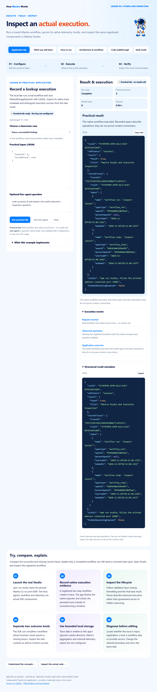

# Mastra · Lesson 08 · Mastra Studio and Execution Inspection

Run a traced Mastra workflow, persist its native telemetry locally, and inspect the same registered components in Mastra Studio.



## What this application does

The local lab runs a real workflow and uses MastraStorageExporter with LibSQL. Inspect its native trace metadata and distinguish execution success from the task result.

**Practical mode:** Real workflow and native stored trace · no model call.

This app configures actual native tracing and local trace storage. It does not publish telemetry externally, expose hidden chain-of-thought, configure aggregate metrics or replace application tests.

## Run the application

Use **Node.js 24+**. Each lesson is an independent repository with its own dependency lockfile.

```powershell
git clone https://github.com/luiscoco/Udemy-Mastra-lesson08-app.git
cd Udemy-Mastra-lesson08-app
npm ci
npm start
```

Open **http://127.0.0.1:3208** and choose **Run practical lab**. The practical operation requires no model key. Starting the server does not make a provider request. Keep the terminal open; Ctrl+C stops it. To change the port, set PORT in the environment or local .env file.

## Application pages

| Page | Content |
| --- | --- |
| Application lab | Editable JSON cases, actual execution, formatted result, event log and structured metadata |
| What you will learn | Lesson objectives, comprehension checks and a concrete exercise |
| How to run | Installation, local/live modes, commands and troubleshooting |
| Architecture & workflow | The practical execution sequence and the actual request runner |
| Code walkthrough | Source-derived excerpts with GitHub line references |

The application supports light/dark themes, mobile layouts, sanitized Markdown, syntax-highlighted code and copy-code controls.

## Practical execution workflow

| Stage | Source | Actual behavior |
| --- | --- | --- |
| Initialize local tracing | [src/mastra/index.ts](src/mastra/index.ts) | Configure LibSQL storage, native Observability, MastraStorageExporter and SensitiveDataFilter. |
| Run actual workflow | [src/mastra/workflows.ts](src/mastra/workflows.ts) | Execute inspectLesson and its inspect-record step over the public catalog. |
| Flush and query storage | [src/lab.ts](src/lab.ts) | Flush the exporter and list the trace filtered to the current runId. |
| Read recorded spans | [src/lab.ts](src/lab.ts) | Read the stored trace and project names, span types, parent ids and timestamps. |

The browser posts JSON to **POST /api/lab**. The host validates the envelope, runs the lesson implementation and sends NDJSON events. The UI renders the actual result and a separate application outcome. **GET /api/config** exposes public lesson metadata and credential-presence readiness, never credential values.

## Classroom cases and expected outcomes

### 1. Trace a successful lookup

```json
{
  "lessonId": 8,
  "includeTrace": true
}
```

**Expected:** A real workflow result and persisted native trace metadata.

### 2. Trace a missing record

```json
{
  "lessonId": 999,
  "includeTrace": true
}
```

**Expected:** A trace of the execution with a missing-record business outcome.

## Interpreting the result

- A missing lesson record is a business failure even when the workflow executes successfully.
- Recorded spans are operational evidence; they do not expose hidden reasoning or prove an answer correct.
- npm run studio uses mastra dev; server.port selects 4208. Runtime data under .mastra is ignored by Git.
- This LibSQL example demonstrates traces, not aggregate metrics.

**Complete** means the operation met its implemented completion checks. **Needs attention** exposes a business, format or validation finding. **Could not finish** is an execution/request failure. **Cancelled** is a separate user action. Read the evidence before treating any runtime status as task correctness.

## Optional live-agent workflow

1. The traced catalog workflow runs first.
2. The registered tutor explains the observed evidence and its limitations; tracing is flushed afterward.

The live button uses **POST /api/query** and a real provider, and may incur API usage. Tests use an explicit SDK model adapter; no paid provider call is claimed by the test evidence.

Configure your own credentials locally, preserving any existing .env:

```powershell
if (!(Test-Path .env)) { Copy-Item .env.example .env }
notepad .env
```

```dotenv
# Set your own provider credential locally. No credential is copied from another app.
OPENAI_API_KEY=your_api_key
MASTRA_MODEL=openai/gpt-4.1-mini
PORT=3208
```

Choose a model your account can access and restart the server. Credentials remain on the host and are ignored by Git. Existing shell values take precedence over the optional .env file. Provider/model availability and supported parameters must be checked for your selected model.

## Mastra Studio

```powershell
npm run studio
```

This executes the pinned Mastra CLI with **mastra dev**. The exported Mastra instance in **src/mastra/index.ts** configures **server.port=4208**; follow the URL printed by the running CLI. Studio runs separately from the student application. Local trace data is stored under the ignored .mastra directory. No external telemetry exporter is configured.

## Build, samples and verification

```powershell
npm run sample
npm run build
npm test
npm run test:browser
```

- **sample:** executes the default practical case without a provider key.
- **sample:live:** runs an actual provider request after configuration; invoke separately with npm run sample:live.
- **build:** regenerates all five pages, actual-source excerpts, architecture SVG, this README and the browser bundle.
- **test:** typechecks and runs offline local-operation, invalid-input, cancellation, real-SDK adapter, generated-content and HTTP-boundary checks, plus lesson-specific regression cases.
- **test:browser:** uses isolated headless Chrome to execute the real practical lab and its failure case, verify all five pages and mobile layout, check theme persistence, syntax colors and safe Markdown, and save [browser evidence](docs/browser-qa.json). The live-renderer fixture makes no provider request.

Set BROWSER_EXECUTABLE if Chrome/Chromium is not installed at the platform’s standard path. Browser tests are local; GitHub Actions runs npm ci, build and the offline test suite.

## Dependencies

| Runtime package | Pinned version |
| --- | --- |
| @mastra/core | 1.81.0 |
| dompurify | 3.4.17 |
| marked | 18.1.3 |
| zod | 4.6.7 |
| @mastra/observability | 1.23.0 |
| @mastra/libsql | 1.28.0 |

The Studio CLI is pinned to **mastra 1.37.0**.

The committed package-lock.json fixes the installed dependency tree. A remote model alias is independent of the JavaScript lockfile.

## Student exercise

Compare the successful and missing-record traces. Explain why a completed workflow can still need a corrected task input. Open Studio and inspect the registered workflow.

Rebuild after a source change so the explanation pages, line references and README remain consistent with the running code.

## Source and references

- [src/lab.ts](src/lab.ts)
- [src/mastra/index.ts](src/mastra/index.ts)
- [src/mastra/workflows.ts](src/mastra/workflows.ts)
- [src/mastra/agents.ts](src/mastra/agents.ts)
- [HTTP host](src/server.ts)
- [Execution envelope](src/runner.ts)
- [Page and README generator](scripts/build-pages.ts)
- [Observability configuration](https://mastra.ai/docs/observability/overview)
- [Mastra workflows](https://mastra.ai/docs/workflows/overview)

Prism’s license is included in [public/prism-LICENSE.txt](public/prism-LICENSE.txt).
